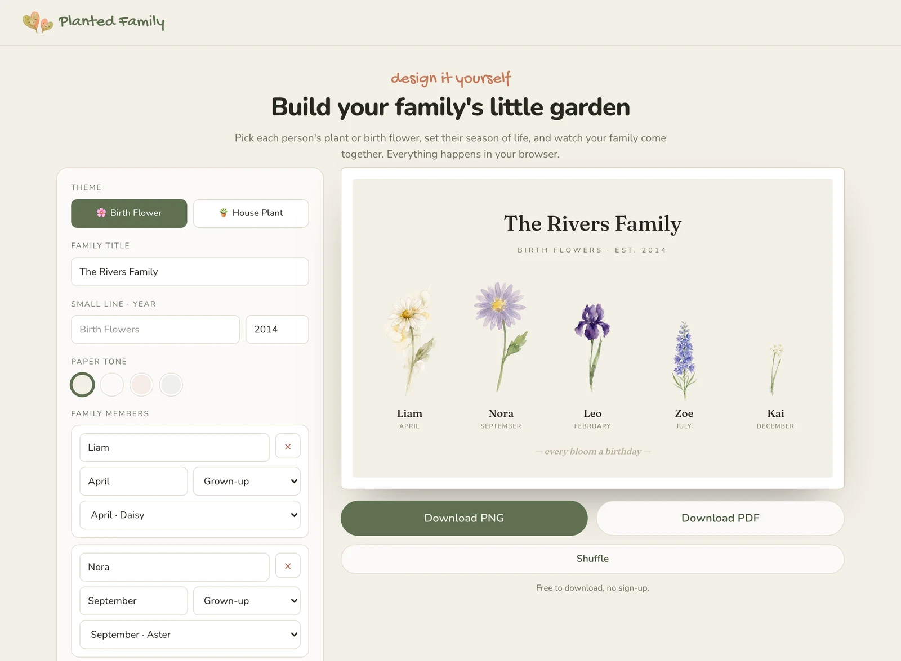
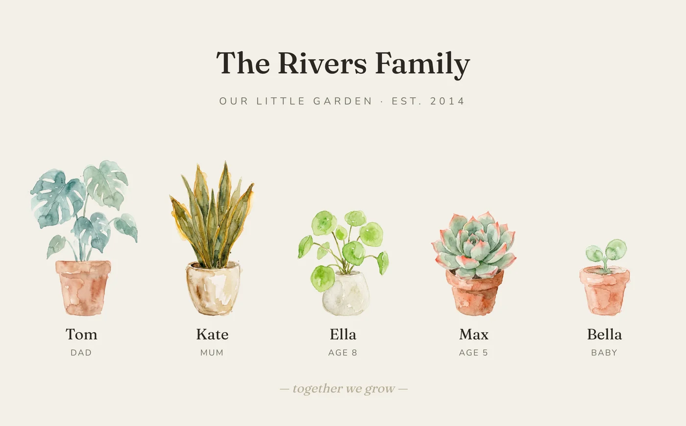
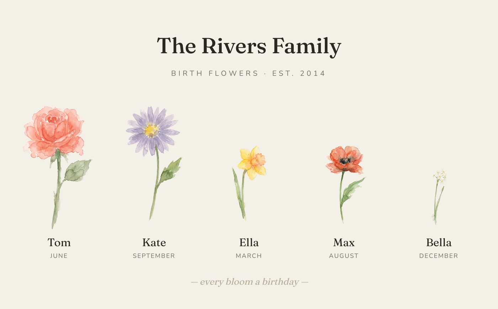

# Watercolor Family Print Generator

A free, open-source generator for personalised watercolor family prints, by
[Planted Family](https://plantedfamily.com). Each person in the family becomes a house plant or
their birth-month flower, sized by their stage of life, and everyone stands on the same shelf. The
print downloads as a PNG or PDF, made entirely in the browser.

**Try it:** [plantedfamily.com/create](https://plantedfamily.com/create/)



| House plants                                                               | Birth flowers                                                                       |
| -------------------------------------------------------------------------- | ----------------------------------------------------------------------------------- |
|  |  |

## What it does

- Two themes: house plants, or one birth flower per month (pick a month and its flower appears).
- Up to six people, each with a name, a small label and a life stage (grown-up, elder, teen, child, baby).
- Extras for both themes: a paw for a pet, and a butterfly, forget-me-not or infinity sign for someone you've lost.
- Four paper tones. Downloads as PNG or PDF.

There is no backend, no account and no upload: the print is made in the browser. (Fonts load from Google Fonts.)

## How it works

A few parts that were harder than they look:

- **What you see is what you download.** The preview is a normal DOM node; export renders that
  same node to a canvas with [modern-screenshot](https://github.com/qq15725/modern-screenshot).
  The PDF page takes the design's own proportions instead of forcing A4/A3, so nothing gets
  letterboxed.
- **The same resolution on every device.** Instead of a fixed pixel ratio, the export scale is
  derived from a target long edge of 2,800 px. A phone and a laptop export at roughly the same resolution, while staying under iOS Safari's canvas size limit. (Phones use a narrower layout, so the composition differs.)
- **Two image sizes.** The preview uses lighter WebP files (`public/library`). At export time each one is swapped for the largest version available (`public/library-hq`), inlined as a data URL.
  Inlining also stops WebKit from dropping images it hasn't painted yet.
- **Life stage survives narrow screens.** Every object is drawn at its life-stage height. If any
  object is too wide for its column, the whole family is scaled by the same factor, so a teen can
  never end up taller than a grown-up just because the grown-up's plant happens to be wide.
- **Names never break mid-word.** All names on a print share one font size, which is shrunk by
  measuring the real rendered width until they fit. Past a minimum size, the text is shortened with an ellipsis.

The logic lives in [`src/scripts/generator.ts`](src/scripts/generator.ts); markup and print
styles are in [`src/components/Generator.astro`](src/components/Generator.astro).

## Run it locally

Requires Node 22.23.4 or newer.

```sh
npm install
npm run dev      # http://localhost:4321
npm run build    # static site in dist/
```

The output is a plain static site and can be hosted anywhere.

## Adding your own illustrations

Objects are looked up by id: `public/library/<id>.webp` for the preview and
`public/library-hq/<id>.webp` for export. Use transparent PNG-style WebP files with the object
standing on the bottom edge. Then add the id and its label to `OBJECT_LABEL` and to `PLANTS`,
`EXTRAS` or `MONTH_FLOWER` in `generator.ts`. If a high-res file is missing, the export falls
back to the preview image.

## License

- Code: [MIT](LICENSE)
- Illustrations and emblem: [CC0 1.0](ASSETS-LICENSE.md), free to use for anything.

The illustrations were made with AI image generation and then cut out onto transparent backgrounds.
